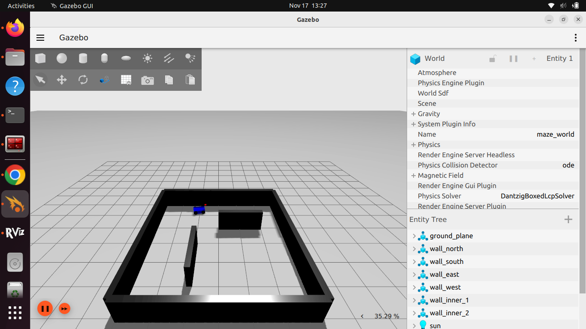
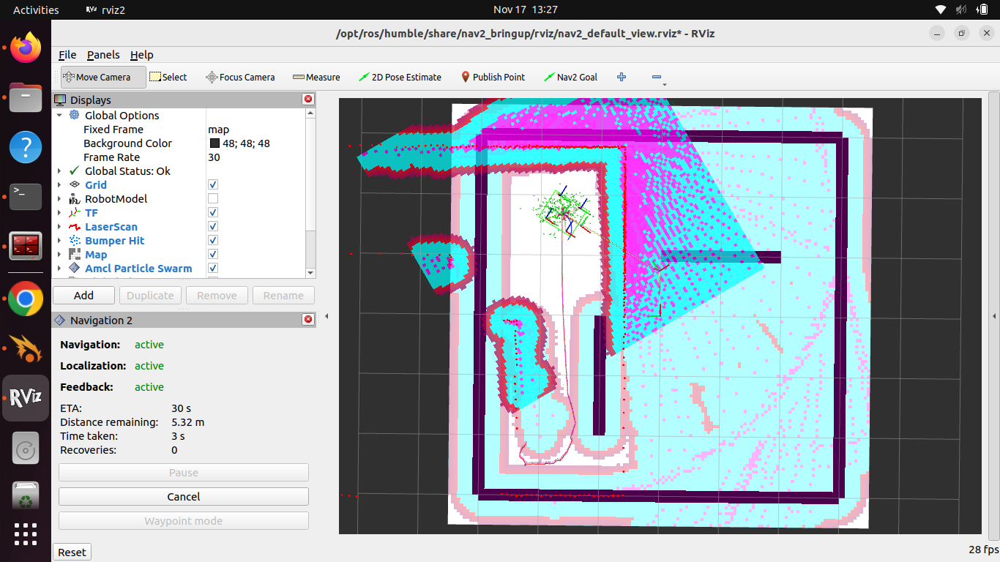

# ROS 2 Mobile Robot Simulation with Gazebo and Nav2

A ROS 2 Humble mobile-robot simulation using Gazebo Fortress and Nav2 for map-based localization, global path planning, goal navigation, and LiDAR-based obstacle avoidance.

## Project status

The package was built successfully in the author's Ubuntu 22.04 / ROS 2 Humble environment. During the latest runtime verification, the following Nav2 lifecycle nodes were confirmed active:

- `/controller_server`
- `/planner_server`
- `/behavior_server`
- `/bt_navigator`

The `/ros_gz_bridge` node was present, and the following ROS topics were available: `/clock`, `/cmd_vel`, `/odom`, `/scan`, and `/tf`.

The screenshots in `docs/images/` show the Gazebo maze world and RViz2 Nav2 visualization. These demonstrate the simulation and navigation interface; they are not a claim of exhaustive dynamic-obstacle validation.

## Package contents

The ROS 2 package is provided in [sim_mobile_robot_nav2.zip](sim_mobile_robot_nav2.zip). It contains:

- Gazebo maze world and robot URDF
- ROS-Gazebo bridge launch configuration
- Nav2 launch file and parameter configuration
- Occupancy-grid map (YAML + PGM)
- Nav2 setup guide and package tests
- Existing robot utility nodes

## Screenshots

### Gazebo maze world



### RViz2 Nav2 visualization



## Requirements

- Ubuntu 22.04
- ROS 2 Humble
- Gazebo Fortress / `ros_gz`
- Nav2
- `colcon`

Install the primary dependencies:

```bash
sudo apt update
sudo apt install -y \
  ros-humble-navigation2 \
  ros-humble-nav2-bringup \
  ros-humble-ros-gz-sim \
  ros-humble-ros-gz-bridge \
  python3-colcon-common-extensions
```

## Extract, build, and run

```bash
mkdir -p ~/nav_ws/src
unzip sim_mobile_robot_nav2.zip -d ~/nav_ws/src
cd ~/nav_ws
source /opt/ros/humble/setup.bash
rosdep install --from-paths src --ignore-src -r -y
colcon build --symlink-install --packages-select sim_mobile_robot
source install/setup.bash
ros2 launch sim_mobile_robot navigation.launch.py
```

The launch command starts the Gazebo simulation, localization, Nav2 navigation, and RViz2. In RViz2, set the robot's initial pose with **2D Pose Estimate**, then send a goal with **Nav2 Goal** / **2D Goal Pose**.

For full installation details, launch arguments, terminal goal examples, dynamic-obstacle insertion, troubleshooting, and tests, see [NAV2_GUIDE.md](https://github.com/abdur-netizen/ros2-mobile-robot-nav2-gazebo/blob/main/sim_mobile_robot/docs/NAV2_GUIDE.md) inside the extracted package.

## Important notes

- The included `dynamic_obstacle.sdf` is a static cylinder that can be spawned after navigation starts. It is a newly introduced obstacle, not an autonomously moving actor.
- Verify that the map geometry matches the Gazebo world if you modify the maze.
- Run the documented live checks for TF, scan, localization, costmaps, and navigation before relying on the simulation.
- Package tests and a successful build do not replace a full live integration test.

## License

The ROS 2 package declares Apache-2.0 in `package.xml`.
